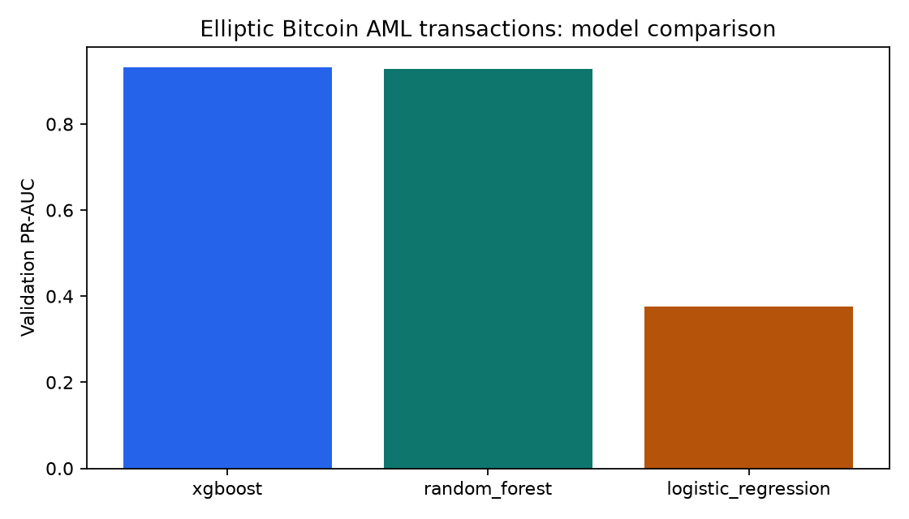
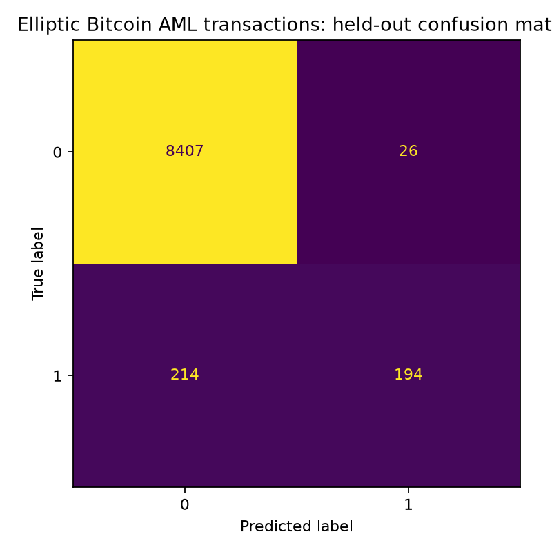

# Elliptic Real Bitcoin AML ML

Standalone PyCharm project for the real, anonymized Elliptic Bitcoin transaction graph. The experiment
compares class-weighted logistic regression, random forest, and XGBoost using published node features and
a strict blockchain-time split.

## Dataset

- [Canonical Elliptic distribution](https://www.kaggle.com/datasets/ellipticco/elliptic-data-set)
- Real Bitcoin transaction graph labelled as licit, illicit or unknown
- 203,769 transaction nodes over 49 time steps
- Canonical licence: CC BY-NC-ND 4.0; verify terms before redistribution

This baseline trains only on labelled nodes and uses the 165 published node features. It does not use the edge list, so it is a tabular baseline rather than a graph neural network. Unknown labels are excluded rather than treated as legitimate.

## PyCharm setup and run

Open the whole folder and create a Python 3.11 virtual environment:

```bash
python -m pip install --upgrade pip
python -m pip install -e ".[dev]"
python scripts/download_data.py
python preprocess_data/run.py
python training_model/train.py
python evaluation/evaluate.py
python scripts/export_example.py
python -m fraudbench.inference examples/sample_transaction.json
python -m uvicorn fraudbench.api:app --host 127.0.0.1 --port 8070
```

Raw data and generated processed rows remain ignored by Git.

## Folder guide

| Folder | Contents |
|---|---|
| `dataset` | Source, licence and limitations |
| `preprocess_data` | Label filtering and temporal split |
| `preprocessed_df` | Generated labelled model table |
| `training_model` | Baseline training entrypoint |
| `checkpoint` | Selected `.joblib` model |
| `evaluation` | Evaluation entrypoint |
| `outputs` | Metrics, predictions and charts |
| `utils` | Team helper scripts |

## Evaluation design

- Time steps 1–34 train the models.
- Steps 35–41 select the model and threshold.
- Steps 42–49 are held out for final evaluation.
- `time_step` and transaction IDs are not model inputs.
- PR-AUC is the selection metric due to severe class imbalance.

## Citation

Weber, M. et al., “Anti-Money Laundering in Bitcoin: Experimenting with Graph Convolutional Networks for Financial Forensics,” 2019.

## Current trained result

XGBoost was selected with validation PR-AUC **0.9321**. On labelled nodes from later blockchain time steps
42–49 it achieved PR-AUC **0.5533**, ROC-AUC **0.8463**, precision **0.8818**, recall **0.4755**, and F1
**0.6178**. The large reduction from validation performance is reported as temporal distribution shift,
not hidden by random splitting.




